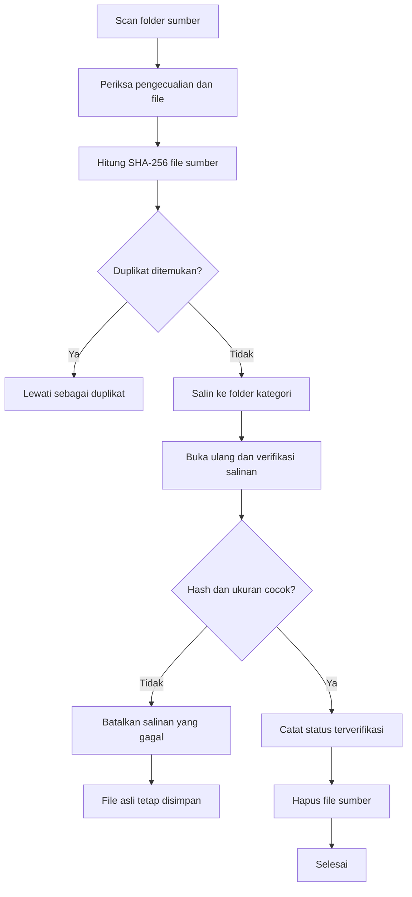

# Organizer

<p align="center">
  <strong>Organize your files. Keep your originals safe.</strong>
  <br />
  Aplikasi Android untuk merapikan file secara otomatis berdasarkan kategori dengan proses pemindahan yang mengutamakan integritas data.
</p>

<p align="center">
  <a href="https://github.com/henraaditias/Organizer/actions/runs/44473118793">
    
  </a>
  
  
  
</p>

<p align="center">
  <a href="https://github.com/henraaditias/Organizer/actions/runs/44473118793/artifacts/14504633300">
    
  </a>
  <a href="https://github.com/henraaditias/Organizer">
    
  </a>
</p>

---

## Tentang Organizer

**Organizer** adalah aplikasi Android yang membantu mengelompokkan file dari folder yang dipilih ke dalam struktur folder yang lebih rapi. File dikategorikan berdasarkan ekstensi, lalu dipindahkan ke folder `Organized` tanpa menimpa file lain yang sudah ada.

Keamanan data menjadi salah satu fokus utama proyek ini. Organizer menggunakan alur **copy → verify SHA-256 → delete**. File sumber hanya boleh dihapus setelah salinan di tujuan berhasil diverifikasi.

Aplikasi berjalan secara lokal di perangkat. Tidak diperlukan akun atau layanan cloud untuk proses pengorganisasian file.

## Download

<details open>
<summary><strong>Organizer APK — Latest build</strong></summary>

Versi yang tersedia di sini adalah **debug APK** hasil GitHub Actions.

**[Download Organizer APK](https://github.com/henraaditias/Organizer/actions/runs/44473118793/artifacts/14504633300)**

Cara instalasi:

1. Buka tautan download di atas.
2. Unduh artifact bernama `Organizer-Debug-APK`.
3. Ekstrak file ZIP yang diunduh.
4. Buka file APK di perangkat Android.
5. Jika Android meminta izin instalasi dari sumber tersebut, izinkan untuk proses instalasi.
6. Jalankan aplikasi Organizer.

> **Catatan:** Tautan di atas adalah artifact dari GitHub Actions, bukan halaman rilis permanen. Ketersediaan unduhan mengikuti kebijakan retensi artifact GitHub.

</details>

## Fitur

| Fitur | Keterangan |
|---|---|
| Automatic file categorization | Mengelompokkan file berdasarkan ekstensi |
| Custom source folders | Menambahkan folder sumber yang ingin diproses |
| Custom destination | Memilih folder tujuan sendiri atau menggunakan folder sumber |
| Dry-run preview | Melihat perkiraan file, kategori, duplikat, dan kebutuhan ruang sebelum proses |
| SHA-256 verification | Memeriksa integritas file sumber dan salinan tujuan |
| Duplicate detection | Mengenali file identik berdasarkan ukuran dan hash SHA-256 |
| Collision-safe naming | Tidak menimpa file tujuan; nama baru diberi suffix jika diperlukan |
| Excluded subfolders | Mengecualikan subfolder tertentu dari pemindaian |
| Operation history | Melihat riwayat, status, dan detail proses |
| Retry failed operations | Mencoba kembali operasi file yang gagal |
| Background processing | Memproses file menggunakan WorkManager dan foreground notification |
| Optional schedule | Menjalankan pengorganisasian berkala jika diaktifkan |

### Kategori file

File akan dikelompokkan ke dalam folder berikut:

```text
Organized/
├── Images/
├── Videos/
├── Documents/
├── Audio/
├── Archives/
├── Applications/
└── Others/
```

Kategori ditentukan berdasarkan ekstensi file. File dengan ekstensi yang belum dikenali akan dimasukkan ke `Others`.

## Mekanisme keamanan file

Organizer dirancang agar proses pemindahan tidak mengorbankan file asli ketika terjadi kesalahan.

Alur pemindahan:



Prinsip keamanan yang diterapkan:

- **Copy before delete:** file sumber tidak dihapus sebelum salinan selesai dibuat.
- **SHA-256 verification:** salinan dibuka ulang dan hash-nya dibandingkan dengan file sumber sebelum penghapusan.
- **No deletion on verification failure:** jika verifikasi gagal, file asli tetap dipertahankan.
- **No symbolic-link traversal:** symbolic link tidak diikuti saat pemindaian maupun pemrosesan.
- **Organized folder exclusion:** folder `Organized` tidak dipindai kembali sebagai sumber.
- **Excluded folder support:** subfolder yang dikecualikan tidak diproses.
- **No overwrite:** file yang memiliki nama sama tidak langsung menimpa file yang sudah ada.
- **Storage pre-check:** aplikasi memeriksa ruang penyimpanan tujuan sebelum menyalin file.
- **Recoverable operations:** status operasi disimpan agar proses yang terhenti dapat ditinjau atau dilanjutkan.

> **Penting:** Selalu simpan cadangan untuk file penting. Mekanisme keamanan mengurangi risiko kehilangan data, tetapi tidak dapat menjamin perlindungan dari semua kegagalan perangkat, penyimpanan, atau penyedia dokumen Android.

## Cara menggunakan

1. Buka Organizer.
2. Tambahkan satu atau beberapa folder sumber.
3. Pilih folder tujuan khusus jika ingin menyimpan hasil di lokasi berbeda. Jika tidak, Organizer membuat folder `Organized` di dalam masing-masing folder sumber.
4. Tinjau preview / dry-run untuk memeriksa file yang akan diproses.
5. Pilih **Organize** atau **Organize All** untuk memulai.
6. Pantau progres melalui dashboard dan notifikasi.
7. Buka **History** untuk memeriksa hasil, detail file, atau mencoba kembali operasi yang gagal.
8. Buka **Schedule** jika ingin mengaktifkan pengorganisasian berkala. Fitur jadwal dinonaktifkan secara default.

### Izin Android

Organizer memerlukan akses ke folder yang dipilih agar dapat membaca dan mengelola file. Berikan izin melalui pemilih folder Android. Pada perangkat atau lokasi penyimpanan tertentu, Android dapat meminta izin akses file tambahan.

Berikan izin hanya jika kamu memahami tujuan penggunaannya dan memang ingin folder tersebut dikelola oleh Organizer.

## Teknologi

- **Kotlin** — bahasa pemrograman utama.
- **Jetpack Compose** — antarmuka pengguna deklaratif.
- **Android Storage Access Framework (SAF) & DocumentFile** — akses folder dan dokumen.
- **Room** — penyimpanan lokal untuk riwayat dan status operasi.
- **WorkManager** — pekerjaan latar belakang dan penjadwalan.
- **Kotlin Coroutines** — operasi asynchronous.
- **SHA-256** — verifikasi integritas file.
- **GitHub Actions** — build APK secara otomatis di cloud.

## Menjalankan project secara lokal

### Persyaratan

- Android Studio versi yang mendukung konfigurasi proyek ini, atau Android SDK + Gradle.
- JDK 21 untuk workflow build saat ini.
- Android SDK Platform 36.1 sesuai konfigurasi proyek.

### Clone repository

```bash
git clone https://github.com/henraaditias/Organizer.git
cd Organizer
```

### Build debug APK

Jika Android SDK dan Gradle sudah tersedia:

```bash
gradle :app:assembleDebug
```

APK debug akan dihasilkan di:

```text
app/build/outputs/apk/debug/
```

### Build melalui GitHub Actions

Repository menyediakan workflow **Build Android APK** yang dapat dijalankan secara manual melalui tab **Actions**. Workflow juga berjalan ketika ada push ke branch `main`.

Artifact hasil build tersedia pada halaman run GitHub Actions terkait.

## Struktur project

Gambaran bagian utama source code:

```text
app/src/main/java/com/example/
├── data/
│   ├── engine/       # Pemindaian, akses, dan pemrosesan file
│   ├── local/        # Room database dan DAO
│   └── repository/   # Penghubung data dan proses aplikasi
├── domain/           # Kategori file dan model keamanan
├── service/          # Foreground service dan notifikasi
├── ui/
│   ├── components/   # Komponen antarmuka
│   ├── screens/      # Dashboard, History, Schedule
│   └── theme/        # Tema aplikasi
└── worker/           # Background worker
```

## Status project

Organizer masih dalam tahap pengembangan. Build APK yang ditautkan di README ini merupakan **debug build** untuk pengujian, bukan pernyataan bahwa aplikasi sudah siap untuk distribusi produksi.

Sebelum digunakan untuk mengelola banyak file penting, lakukan pengujian terlebih dahulu pada folder salinan atau data yang tidak kritis.

## Kontribusi dan laporan masalah

Ide, saran, dan laporan bug sangat terbuka.

- [Laporkan bug atau ajukan fitur melalui GitHub Issues](https://github.com/henraaditias/Organizer/issues).
- [Lihat source code Organizer](https://github.com/henraaditias/Organizer).

## Lisensi

Belum ada file lisensi yang disertakan dalam repository ini. Sampai lisensi ditambahkan, jangan mengasumsikan bahwa kode dapat digunakan ulang, dimodifikasi, atau didistribusikan secara bebas.

---

<p align="center">
  Dibuat dengan fokus pada kerapian file dan keamanan data.
  <br />
  <a href="https://github.com/henraaditias">GitHub: @henraaditias</a>
</p>
